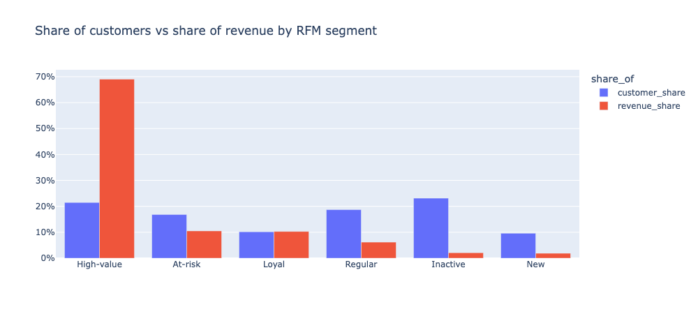
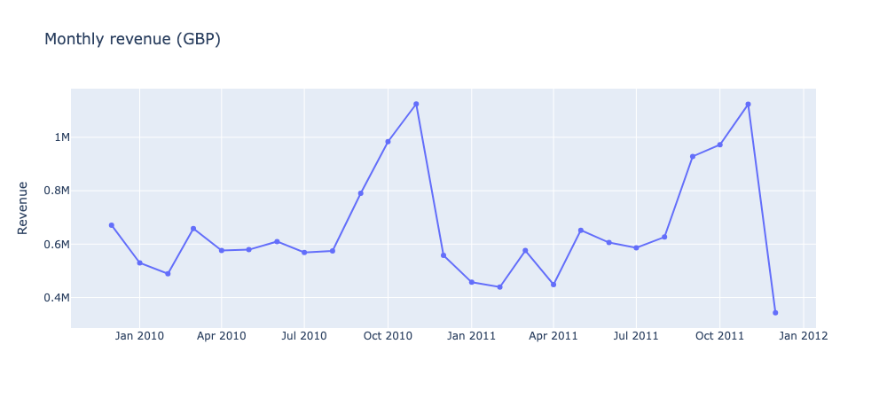
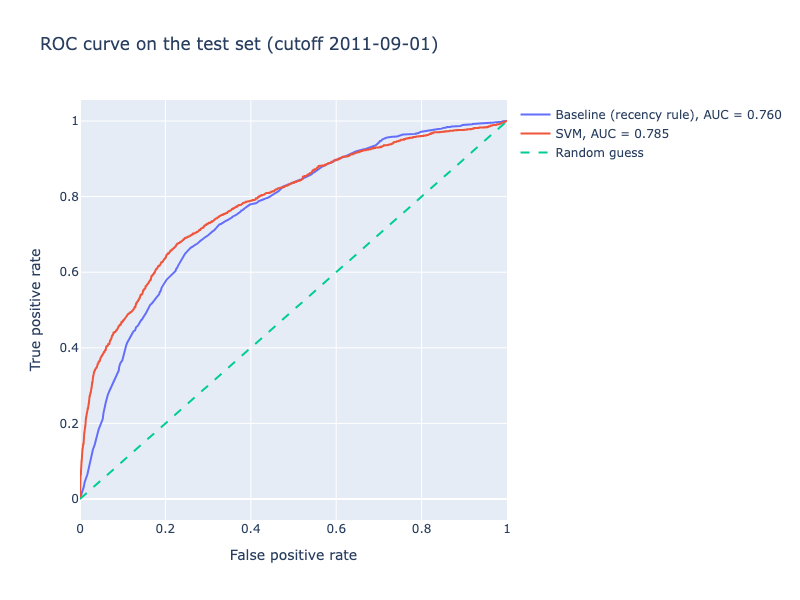
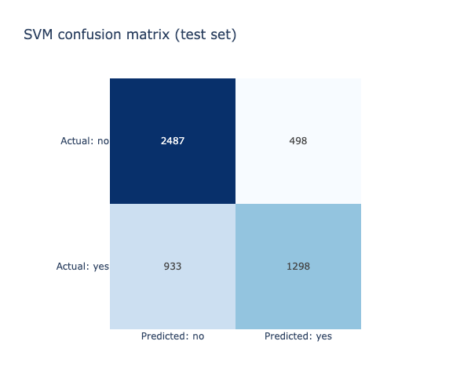
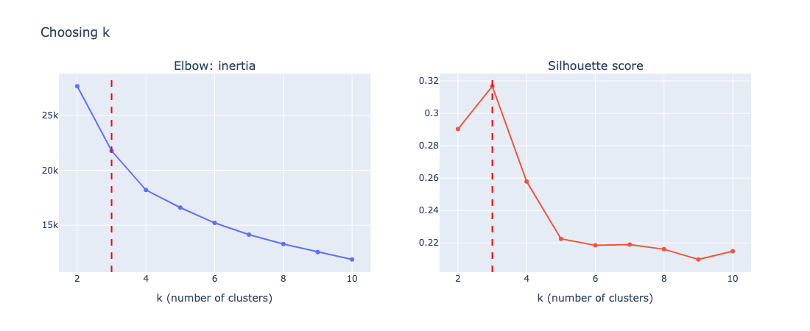
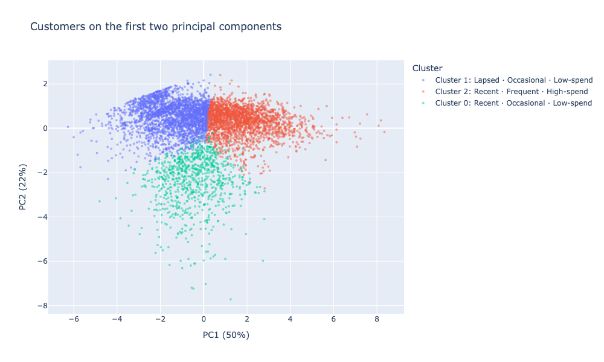
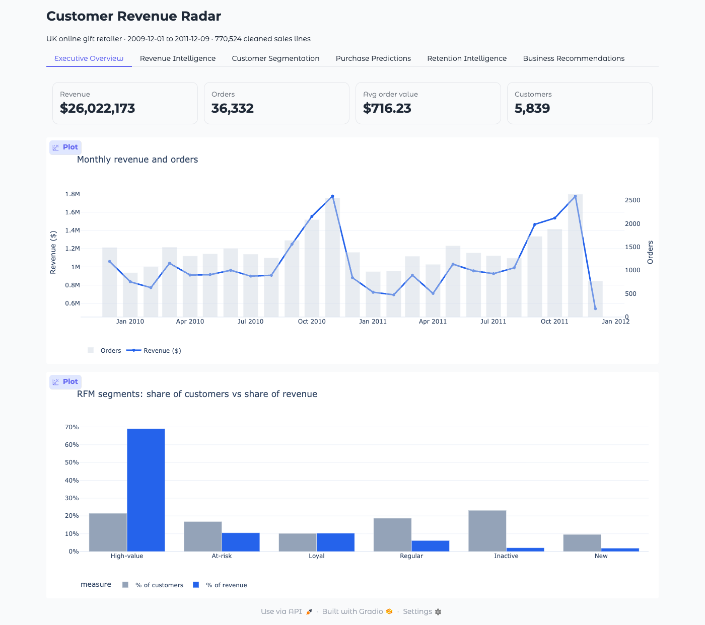
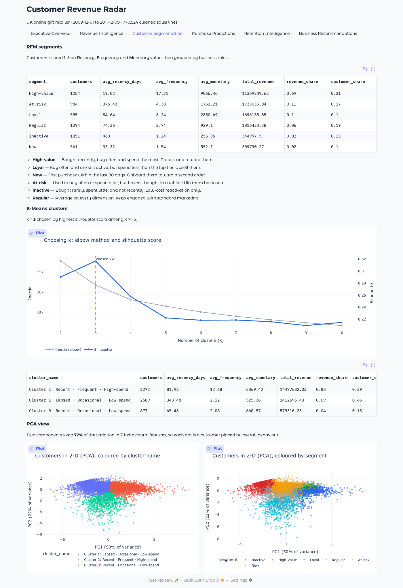
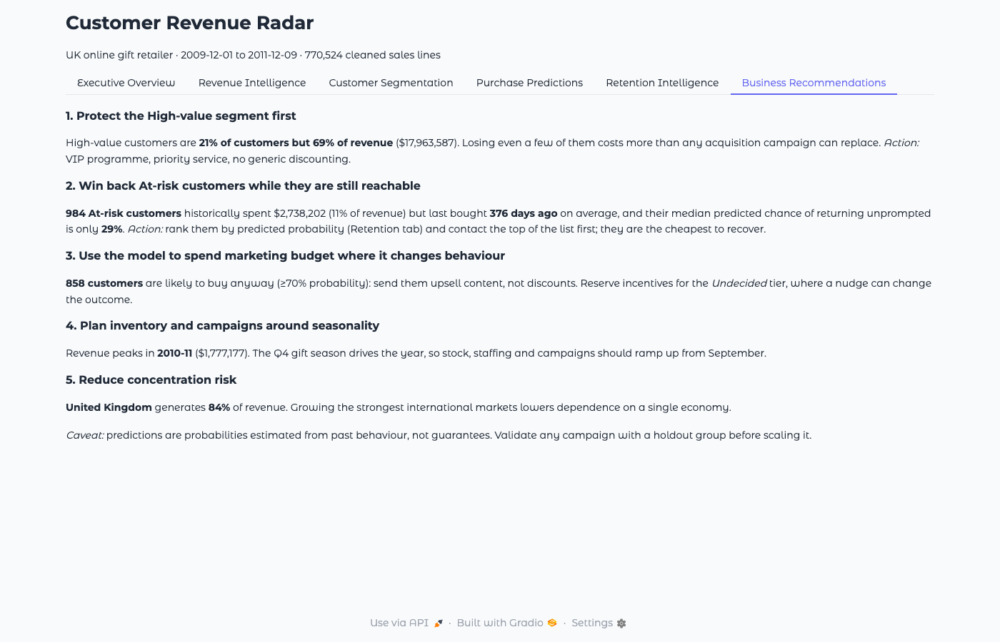

# Customer Revenue Radar

**Who are the best customers, and who is about to leave? - Customer value analysis, segmentation and repeat-purchase prediction via RFM, K-Means, PCA and SVM**

A UK online gift wholesaler made **$26.0M** over two years, and **21% of its customers brought in 69% of
that revenue**. I found those customers, flagged the 984 big spenders who have gone quiet ($2.74M of past
spend), and built a model that predicts who will order again in the next 90 days (ROC-AUC 0.785 vs 0.760
for a simple "bought recently" rule). That tells the business where to spend retention money first.

- **Dataset:** [UCI Online Retail II](https://archive.ics.uci.edu/dataset/502/online+retail+ii), Dec 2009 to Dec 2011, 1,067,371 rows x 8 columns, cleaned down to 770,524 sales lines from 5,839 customers. Prices converted at one fixed rate (1 GBP = 1.58 USD).
- **Methods:** pandas cleaning, SQL on SQLite for revenue analysis, RFM scoring, K-Means clustering with PCA, and an RBF-kernel SVM tested against a simple rule, plus a Gradio dashboard.
- **Angle:** every model is compared against a simple baseline and every cleaning step is counted. The model beats the baseline by only +0.025 ROC-AUC, because recency alone does most of the work.

**Contents:** [Key Results](#key-results) · [What I Did](#what-i-did) · [So What](#so-what) · [Deep Dives](#deep-dives) · [Limitations](#limitations--next-steps) · [Glossary](#glossary)

## Key Results

| Area | Metric | Value |
|---|---|---|
| Data | Rows kept after cleaning | 770,524 of 1,067,371 (72.2%) |
| Revenue | Total revenue / orders / average order | $26.0M / 36,332 / $716 |
| Revenue | Sep to Nov share of revenue | 36% |
| Revenue | UK share of revenue | 83.5% |
| Customers | High-value segment | 21% of customers, 69% of revenue |
| Customers | At-risk segment | 984 customers, $2.74M past spend, last order ~376 days ago |
| Customers | One-time buyers | 27.6% of customers |
| Segments | K-Means clusters / silhouette | 3 / 0.317 |
| Segments | PCA variance kept in 2 dimensions | 72.5% |
| Model | Buy-again ROC-AUC: SVM vs simple rule | 0.785 vs 0.760 (+0.025, 95% CI +0.016 to +0.035) |
| Model | Precision: SVM vs simple rule | 0.723 vs 0.678 |

<p>


</p>

*Left: high-value customers are about a fifth of the base but bring in over two thirds of revenue.
Right: revenue climbs every autumn and peaks in November (~$1.78M); December 2011 is a partial month.*

## What I Did

### 1. Cleaning - [`01_data_cleaning.ipynb`](notebooks/01_data_cleaning.ipynb)
- **Messy part:** the raw file is two yearly Excel sheets stacked together. They overlap from 1 to 9 Dec 2010, which created 34,335 exact duplicates, and 22.8% of raw rows have no customer ID (guest checkouts).
- **Decision:** dropped the no-ID rows, because none of the customer-level work can use them.
- **Rigor:** rules run in order and each row is counted only once, so the removal counts add up exactly to the 296,847 dropped rows. A `validate_clean` check fails loudly if any rule is broken afterwards.

### 2. Exploratory analysis - [`02_exploratory_analysis.ipynb`](notebooks/02_exploratory_analysis.ipynb)
- **Work:** all numbers come from parameterised SQL against SQLite, so the notebook and dashboard share one source.
- **Dead end:** my first top-products chart was led by an 80,995-unit order that was cancelled minutes later. Dropping the "C" (cancellation) invoices alone left the original sale in the data.
- **Fix:** added a `cancelled_sales` rule that matches each cancellation to the most recent identical sale before it, removing 6,209 rows.
- **Findings:** Saturday is 0.06% of revenue, the busiest slot is Wednesday at noon, and 27.6% of customers ordered only once.

### 3. RFM analysis - [`03_rfm_analysis.ipynb`](notebooks/03_rfm_analysis.ipynb)
- **Messy part:** spend is very skewed. The median customer spent $1,346 and the top one $915,023.
- **Decision:** scored recency, frequency and spend by quintile instead of raw values, then turned the scores into 6 segments with simple rules a marketing team can read and question.

### 4. K-Means + PCA segmentation - [`04_customer_segmentation.ipynb`](notebooks/04_customer_segmentation.ipynb)
- **Work:** ran K-Means on 7 behaviour features after a log transform and standard scaling, testing k = 2 to 10.
- **Trade-off:** k = 2 scored a silhouette of 0.290 but only splits "good" from "bad" customers, which RFM already does, so I took the best k of 3 or more: k = 3 at 0.317.
- **Sanity check:** a cross-tab showed 64% of the "Recent, Occasional" cluster are RFM "New" customers, so the two methods mostly agree.

### 5. Purchase prediction - [`05_purchase_prediction.ipynb`](notebooks/05_purchase_prediction.ipynb)
- **Question:** will a customer order again within 90 days of a cutoff date?
- **No peeking at the future:** split by time (train Jun 2010 to Feb 2011, validate Jun 2011, test Sep 2011) and built features only from purchases before each cutoff.
- **Trade-off:** the SVM took minutes per fit, so I trained on 15,000 of the 32,392 training rows, and the notebook loads the saved model instead of retraining.
- **Humbling result:** a "bought in the last 90 days" rule already reaches 0.760 ROC-AUC, and the SVM adds only +0.025. Its real gain is precision: 498 false alarms against the rule's 621.

## So What

| Recommendation | Evidence |
|---|---|
| **Protect the top 21%** with VIP service and early access, not blanket discounts | High-value customers bring in 69% of revenue ($18.0M); median chance of buying again is 72% |
| **Win back At-risk customers first**, in order of predicted probability | 984 customers who spent $2.74M haven't ordered in ~376 days; median chance of returning alone is 29% |
| **Spend discounts where they change behaviour** | 858 customers are likely to buy anyway (70%+): upsell them. Save incentives for the 1,451 "on the fence" (40-70%) |
| **Plan for the autumn rush** from September | Sep to Nov is 36% of revenue |
| **Reduce UK dependence** | The UK is 83.5% of revenue; the next market, Ireland, is $0.90M from just 3 customer accounts |

## Deep Dives

<details>
<summary><b>Model details and hyperparameters</b></summary>

- **Features (9, all from purchases before the cutoff):** recency, frequency, spend, average order value, unique products, tenure, average days between orders, orders and revenue in the last 90 days.
- **Pipeline:** `log1p` -> `StandardScaler` -> RBF `SVC(class_weight="balanced")`, seed 42.
- **Tuning:** grid over C in {0.1, 0.3, 1.0} and gamma in {0.005, 0.01, 0.02, 0.05}, scored by validation ROC-AUC. Best: C = 1.0, gamma = 0.01 (val ROC-AUC 0.812).
- **Threshold:** 0.39, chosen to maximise F1 on validation.
- **Rows:** train 32,392 (sampled to 15,000), validation 4,900, test 5,216.
- **Share who bought again:** train 44.0%, validation 33.0%, test 42.8%. The June validation window is lower than the September test window, likely a seasonal effect.

| Model (test, Sep 2011) | Precision | Recall | F1 | ROC-AUC | False alarms |
|---|---:|---:|---:|---:|---:|
| Simple rule (bought in last 90 days) | 0.678 | 0.586 | 0.629 | 0.760 | 621 |
| **SVM** | **0.723** | 0.582 | **0.645** | **0.785** | **498** |

The ROC-AUC gain was checked with 1,000 bootstrap resamples: +0.025, 95% CI +0.016 to +0.035.



</details>

<details>
<summary><b>RFM and clustering method</b></summary>

RFM scores are 1 to 5 quintiles (5 = best; for recency, 5 = most recent), scored as of 10 Dec 2011.
Rules are checked in order:

| Segment | Rule | Customers | % customers | % revenue | Avg days since last order |
|---|---|---:|---:|---:|---:|
| High-value | R, F, M all >= 4 | 1,254 | 21% | 69% | 19 |
| Loyal | F >= 4 and R >= 3 | 595 | 10% | 10% | 85 |
| New | first purchase in last 90 days | 561 | 10% | 2% | 35 |
| At-risk | R <= 2 but F or M >= 3 | 984 | 17% | 11% | 376 |
| Inactive | R <= 2 otherwise | 1,351 | 23% | 2% | 460 |
| Regular | everyone else | 1,094 | 19% | 6% | 74 |

**K-Means clusters (k = 3):**
- *Recent, Frequent, High-spend*: 39% of customers, 88% of revenue.
- *Lapsed, Occasional, Low-spend*: 46% of customers, 9% of revenue.
- *Recent, Occasional, Low-spend*: 15% of customers, 4% of revenue.

**PCA** keeps 50.3% + 22.2% = 72.5% of the variance. Axis 1 is driven by spend, frequency and product variety (customer value). Axis 2 is driven by tenure (how long someone has been a customer).



</details>

<details>
<summary><b>Dashboard</b></summary>

A Gradio app with tabs for the overview, revenue, segments, predictions, retention and recommendations.
The recommendation text is generated from the data (`dashboard/insights.py`), so no numbers are hard-coded.

```bash
python -m dashboard.app     # then open http://127.0.0.1:7860
```

| | |
|---|---|
|  |  |
|  |  |
|  |  |
</details>

<details>
<summary><b>Repo layout</b></summary>

```
customer-revenue-radar/
├── notebooks/    # 01-05: the analysis story, in order
├── src/          # config, data (download, clean, SQLite), analytics (SQL revenue, RFM), models (K-Means/PCA, SVM), pipeline
├── dashboard/    # Gradio app, charts, generated recommendation text
├── models/       # saved models + clustering_report.json, prediction_report.json
├── reports/      # findings.md, figures/, screenshots/
├── data/         # raw/ and processed/ (generated, git-ignored except cleaning_report.json)
└── tests/        # pytest suite on synthetic data
```
</details>

<details>
<summary><b>Reproduce it</b></summary>

Requires Python 3.11. The raw data is not stored in the repo; the pipeline downloads it from UCI.

```bash
python3.11 -m venv .venv && source .venv/bin/activate
pip install -r requirements.txt
python -m src.pipeline      # downloads the data, cleans, trains everything
python -m pytest -q         # 25 tests
python -m dashboard.app     # http://127.0.0.1:7860
```

A fixed random seed (42) makes runs repeatable. The notebooks reuse the same `src/` functions, so their numbers match the pipeline.
</details>

## Limitations & Next Steps

- **Guest checkouts are invisible.** About 23% of raw rows have no customer ID, so all customer results cover registered customers only.
- **One test window.** The model is tested on a single 90-day window (autumn 2011), so its score includes seasonal effects. Next step: test across several cutoffs to see how stable the gain over the rule is.
- **Fixed exchange rate and hand-set cutoffs.** One GBP-to-USD rate is used for two years. The segment rules and the 40% / 70% action tiers are business choices, not learned values.
- **Small model gain.** Recency does most of the work. Next step: try a gradient-boosted model or product-level features, and measure real impact with a holdout campaign rather than offline metrics.

## Glossary

<details>
<summary><b>Plain-English definitions of the terms used above</b></summary>

| Term | Meaning |
|---|---|
| RFM | Recency, Frequency, Monetary: how recently, how often and how much a customer buys |
| Quintile | Rank customers, split them into five equal-size groups, score 1 to 5 |
| K-Means | Groups customers who look alike into k clusters |
| Silhouette | 0-1 score of how cleanly clusters separate |
| PCA | Squashes many columns into 2 so customers can be plotted |
| Cross-tab | Count table of one grouping against another |
| SVM (RBF kernel) | A classifier that can draw curved boundaries between buyers and non-buyers |
| ROC-AUC | Chance a real buyer is ranked above a non-buyer (0.5 = coin flip) |
| Precision | Share of predicted buyers who really bought |
| Recall / F1 | Share of real buyers found / balance of precision and recall |
| False alarm | Customer flagged as a buyer who didn't buy |
| Bootstrap | Re-scoring many random re-draws of the test set to measure uncertainty |
| Confidence interval (CI) | The range the true value most likely sits in |
| Gradio | Python library for quick web dashboards |

</details>

---

**Data:** Chen, D. (2012), *Online Retail II*, UCI Machine Learning Repository, [doi:10.24432/C5CG6D](https://doi.org/10.24432/C5CG6D), CC BY 4.0. **Code:** MIT ([`LICENSE`](LICENSE)). Full findings: [`reports/findings.md`](reports/findings.md).
