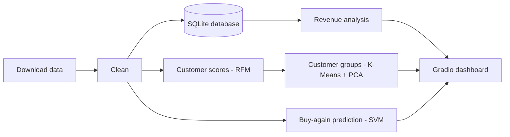
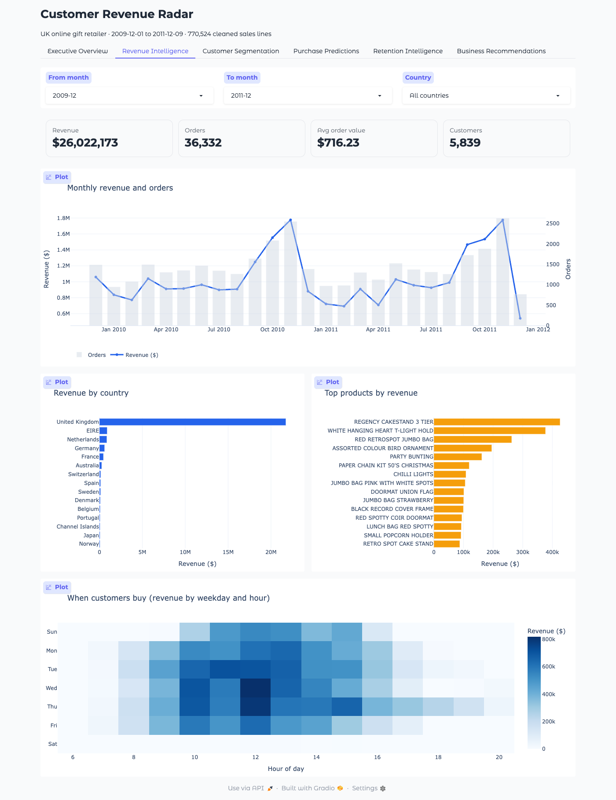
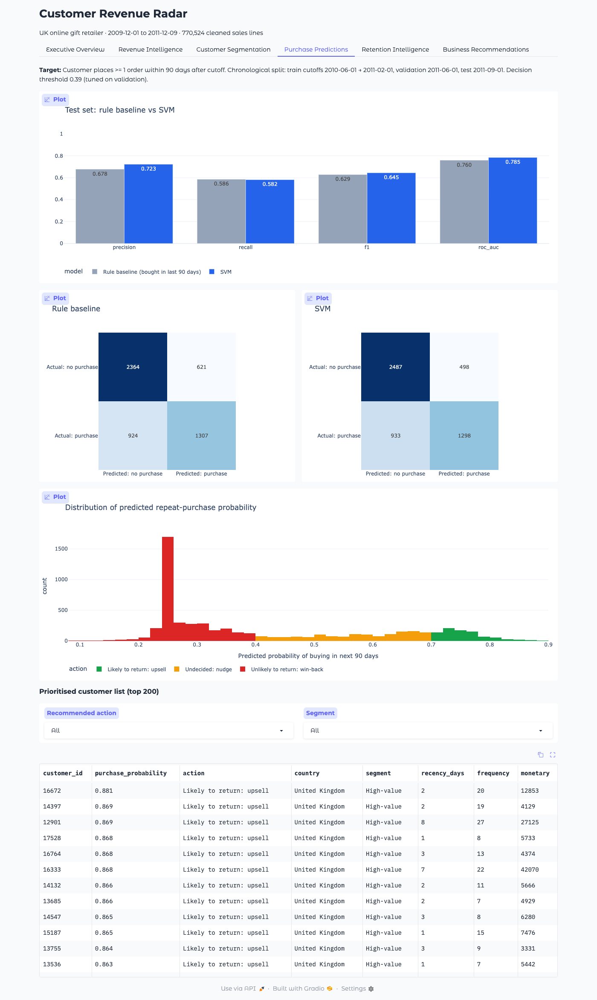

# Customer Revenue Radar

**Who are the best customers, who is about to leave, and who is worth a marketing dollar?**
Answered with 1 million+ real online-store transactions, machine learning, and an interactive dashboard.


## In one minute

- **Data:** [UCI Online Retail II](https://archive.ics.uci.edu/dataset/502/online+retail+ii), a UK online gift shop, Dec 2009 – Dec 2011, 1,067,371 rows.
- **Money:** the raw prices are in British pounds. Everything here is in **US dollars**, converted at one
  fixed rate, **1 GBP = 1.58 USD** (roughly the 2010–2011 average).
- **What it does:** cleans the data, measures revenue, groups customers, predicts who will buy again,
  and shows it all in a dashboard.

## Key findings

| Finding | Result |
|---|---|
| Total revenue | **$26.0M** from 36,332 orders and 5,839 customers |
| Average order | **$716** (many buyers are wholesalers) |
| Best customers | **21% of customers bring in 69% of revenue** |
| Customers slipping away | **984 "At-risk" customers** worth $2.74M, last order ~376 days ago |
| Busiest season | Sep–Nov is **36%** of the year's revenue; November peaks at ~$1.78M |
| One market | The UK is **84%** of revenue |
| One-time buyers | **28%** of customers ordered only once |
| Prediction | The model ranks likely buyers a bit better than a simple rule (score **0.785 vs 0.760**) |

**What a business should do:** give VIP care to the top customers, win back the At-risk group first,
save discounts for customers who are on the fence, and stock up before the Sep–Nov rush.

> Predictions are educated guesses from past behavior, not guarantees. Test any campaign on a small
> group first.

## How it works



| Technical term | In plain terms |
|---|---|
| **RFM** (Recency, Frequency, Monetary) | Scores each customer 1–5 on how recently they bought, how often, and how much they spent |
| **K-Means** | Automatically sorts customers into groups that behave alike |
| **Silhouette score** | How cleanly those groups separate (higher is better); used to pick the number of groups |
| **PCA** | Squashes 7 customer measurements into 2, so customers can be plotted on a flat chart |
| **SVM** (Support Vector Machine) | The model that predicts whether a customer will buy again in 90 days |
| **ROC-AUC** | How well the model ranks buyers above non-buyers: 0.5 is a coin flip, 1.0 is perfect |
| **Data leakage** | Accidentally letting the model peek at the future; prevented by splitting the data by date |

### 1. Cleaning (`src/data/clean.py`)

| Removed | Rows | Why |
|---|---:|---|
| Exact duplicates | 34,335 | The two yearly Excel sheets overlap for 9 days |
| Cancellations and adjustments | 19,110 | Returns and write-offs are not sales |
| Sales that were later cancelled | 6,209 | e.g. an 80,995-unit order cancelled minutes later |
| Quantity or price ≤ 0 | 6,012 | Stock fixes, free samples |
| Postage and fee codes | 4,343 | Not products |
| No customer ID | 226,838 | Guest checkouts can't be tracked over time |
| **Kept** | **770,524** | |

Counts come from `data/processed/cleaning_report.json`.

### 2. Customer groups

- **RFM segments:** High-value, Loyal, New, At-risk, Inactive and Regular, assigned by simple rules on the
  1–5 scores (`src/analytics/rfm.py`).
- **K-Means:** tried 2–10 groups and picked **3**, the best silhouette score (0.317) among options with 3+
  groups. Two groups would only split customers into "good" and "bad", which RFM already does.
  - The biggest-spending group is 39% of customers and 88% of revenue.
- **PCA:** 2 dimensions keep **72.5%** of the information.
  - Axis 1 measures how engaged and valuable a customer is.
  - Axis 2 measures how long they have been a customer.

### 3. Buy-again prediction (`src/models/prediction.py`)

- **Question:** given everything up to a date, will this customer order again within 90 days?
- **No peeking at the future:** the model trains on Jun 2010 – Feb 2011, is tuned on Jun 2011, and is
  tested once on Sep 2011. Tests check that no time windows overlap.
- **Compared against a simple rule:** "they'll buy if they bought in the last 90 days."

| Model | Precision (right when it says "will buy") | Recall (share of buyers found) | ROC-AUC |
|---|---:|---:|---:|
| Simple rule | 0.678 | 0.586 | 0.760 |
| **SVM** | **0.723** | 0.582 | **0.785** |

The improvement is real but small: a +0.025 ROC-AUC gain, 95% confidence range +0.016 to +0.035, from
1,000 bootstrap resamples (re-scoring random re-draws of the test set). Recency alone is already a strong
signal. The SVM's main win is fewer wasted contacts: 498 false alarms against 621.

## Run it yourself

```bash
python3.11 -m venv .venv && source .venv/bin/activate
pip install -r requirements.txt
python -m src.pipeline      # download, clean, and train everything (~2 min)
python -m pytest -q         # 25 tests
python -m dashboard.app     # open http://127.0.0.1:7860
```

Results are identical on every run (fixed random seed 42). The raw data isn't stored in this repo; the
pipeline downloads it.

## Dashboard

| | |
|---|---|
|  |  |
|  |  |

## Project layout

```
src/        config · data (download, clean, database) · analytics (revenue, RFM) · models (K-Means/PCA, SVM)
dashboard/  Gradio app, charts, recommendation text
notebooks/  01–05, the analysis step by step
tests/      pytest suite on synthetic data
models/     saved models + metric reports
reports/    findings.md, figures, screenshots
```

## Limitations

- About 23% of rows have no customer ID, so customer results cover registered customers only.
- One fixed exchange rate is used; real GBP→USD rates moved within roughly 1.4–1.7 over these years.
- The test covers one 90-day window (autumn 2011), so its scores include seasonal effects.
- Segment rules and action cutoffs (40% / 70%) are business choices, not learned values.

**Data:** Chen, D. (2012), *Online Retail II*, UCI Machine Learning Repository,
[doi:10.24432/C5CG6D](https://doi.org/10.24432/C5CG6D), CC BY 4.0. **Code:** MIT license.
More detail: [reports/findings.md](reports/findings.md).
