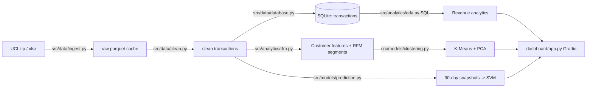
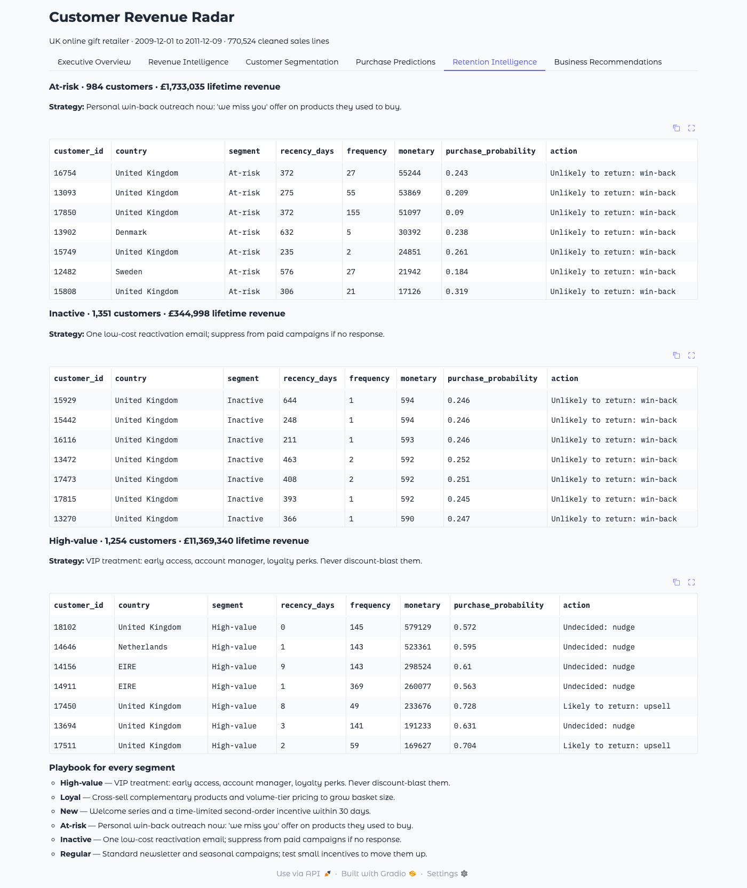

# Customer Revenue Radar

**Find out who your best customers are, who is about to leave, and who is worth a marketing dollar, using two years of real e-commerce transactions.**

Customer Revenue Radar is an end-to-end analytics and machine-learning project built on the
[UCI Online Retail II dataset](https://archive.ics.uci.edu/dataset/502/online+retail+ii)
(1,067,371 transactions from a UK online gift retailer, Dec 2009 – Dec 2011). It cleans the raw data,
analyses revenue, segments customers with RFM and K-Means, predicts repeat purchases with an SVM,
and presents everything in an interactive Gradio dashboard.


---

## For recruiters and business readers

**The business problem.** A retailer has thousands of customers, but they are not equally valuable and
they don't all need the same treatment. Discounting a customer who would have bought anyway wastes margin;
ignoring a valuable customer who is drifting away loses revenue. This project answers three questions:

1. **Where does revenue come from?** By month, country and product.
2. **Who are our customers?** Groups of customers who behave alike, described in plain business terms.
3. **Who will buy again in the next 90 days?** A probability for every customer, used to decide who to
   upsell, who to nudge, and who to win back.

**What the analysis found** (all numbers produced by the code in this repo):

| Finding | Number |
|---|---|
| Revenue after cleaning | **£16.47M** from **36,332 orders** and **5,839 customers** |
| Average order value | **£453** |
| High-value customers | **21% of customers produce 69% of revenue** |
| At-risk customers (used to be good, gone quiet) | **984 customers**, £1.73M lifetime revenue, last order **~376 days ago** on average |
| Seasonality | Sep–Nov delivered **36%** of 2010 revenue; November is the peak month in both years |
| Market concentration | The UK is **84%** of revenue |
| One-time buyers | **28%** of customers ordered only once |
| Purchase prediction | The SVM ranks customers modestly better than a simple "bought in the last 90 days" rule: ROC-AUC **0.785 vs 0.760** (gain 95% CI +0.016 to +0.035) |

**How a business would use it.** Give VIP treatment to the High-value segment. Run a personalised win-back
campaign for At-risk customers, ranked by their predicted chance of returning. Save discounts for the
"Undecided" customers, where a nudge can actually change behaviour, and send upsell content (not
discounts) to customers likely to buy anyway. Plan stock and campaigns around the September–November peak.

> The predictions are probabilities learned from past behaviour, not certainties. Any campaign built on
> them should be tested against a holdout group first.

---

## For technical reviewers

### Architecture



```
src/
  config.py              paths, seeds, cutoff dates (single source of truth)
  pipeline.py            runs everything end to end
  data/                  ingest.py · clean.py · database.py
  analytics/             eda.py (SQL) · rfm.py (features + segments)
  models/                clustering.py (K-Means, PCA) · prediction.py (SVM)
dashboard/               app.py (layout) · charts.py (Plotly) · insights.py (recommendation text)
notebooks/               01–05, thin narratives that call src/
tests/                   pytest unit + integration tests on synthetic data
models/                  persisted models + JSON metric reports
reports/                 findings.md · figures/ · screenshots/
```

### Data and cleaning

Source: Chen, D. (2012). *Online Retail II*. UCI Machine Learning Repository,
[doi:10.24432/C5CG6D](https://doi.org/10.24432/C5CG6D). License: CC BY 4.0. The raw data is **not**
committed; `src/data/ingest.py` downloads it.

Schema: `Invoice, StockCode, Description, Quantity, InvoiceDate, Price, Customer ID, Country`.

Rules are applied in order; each row is counted once, under the first rule that removes it
(see `data/processed/cleaning_report.json`):

| Rule | Rows removed | Why |
|---|---:|---|
| Exact duplicates | 34,335 | The two Excel sheets overlap on 1–9 Dec 2010 |
| Cancellations (`C…`) and adjustments (`A…`) | 19,110 | Returns and bad-debt write-offs aren't sales |
| Cancelled sales | 6,209 | The sale a cancellation reverses (same customer, product and quantity; the latest earlier sale). Without this rule, an order of 80,995 units cancelled minutes later would still count as revenue |
| Quantity ≤ 0 | 3,393 | Stock corrections without a cancellation invoice |
| Price ≤ 0 | 2,619 | Free samples, damages, internal adjustments |
| Non-product stock codes (POST, DOT, M, fees…) | 4,343 | Postage and fees distort product and basket metrics |
| Missing Customer ID | 226,838 | Guest checkouts can't be tracked across purchases |
| **Kept** | **770,524** | 5,839 customers, 36,332 invoices |

Revenue is net of exactly matched cancellations. Partial returns that don't match a sale line one-for-one
are dropped as cancellation rows, not netted off.

### Customer features

`customer_features(transactions, as_of)` computes, using only transactions **before** `as_of`: recency,
frequency (distinct invoices), monetary (total spend), average order value, tenure, average days between
orders, distinct products, plus orders and revenue in the last 90 days.

### RFM segmentation

R, F and M are scored 1–5 by percentile rank. Tied values always get the same score, so all 1,600+
one-order customers share F = 1, even though that makes the bins unequal. The scores are then mapped by transparent rules to *High-value, Loyal, New, At-risk, Inactive* and *Regular*
(`src/analytics/rfm.py`).

### K-Means and PCA

* Seven behavioural features, `log1p` transformed (spend and frequency are heavily right-skewed), then standardised.
* k = 2…10 evaluated with inertia (elbow) and silhouette score. **Selection rule: the highest silhouette
  among k ≥ 3** (k = 2 only splits customers into good and bad, which RFM already does). The result is
  **k = 3** (silhouette 0.317, against 0.290 for k = 2 and 0.258 for k = 4).
* Clusters are labelled by comparing their medians with the overall customer medians: *Recent · Frequent ·
  High-spend* (39% of customers, 88% of revenue), *Lapsed · Occasional · Low-spend* (46%, 9%), and
  *Recent · Occasional · Low-spend* (15%, 4%, mostly new customers).
* PCA reduces the same features to 2 components that keep **72.5%** of the variance (PC1 50%, PC2 22%).
  PC1 measures engagement and value: frequency, spend and product variety load positively, recency
  negatively. PC2 mostly measures tenure (loading 0.73).

### SVM purchase prediction

* **Target:** for a cutoff date T, a customer with ≥ 1 purchase before T is labelled 1 if they place ≥ 1 order
  in `[T, T + 90 days)`, otherwise 0.
* **Chronological split with no overlapping windows:**
  train cutoffs monthly 2010-06-01 → 2011-02-01 (32,392 customer-snapshots), validation 2011-06-01 (4,900),
  test 2011-09-01 (5,216). Every training label window closes before the validation cutoff, and every
  validation window closes before the test cutoff. Unit tests enforce this, and also check that the
  features don't change when future rows are deleted.
* **Model:** `log1p → StandardScaler → SVC(rbf, class_weight="balanced")`. C and gamma are tuned on
  validation ROC-AUC (12-point grid). The decision threshold maximises validation F1 (0.40). Training uses a
  seeded 15,000-row sample, because SVM fitting time grows roughly quadratically.
* **Baseline:** the rule "will buy if they bought in the last 90 days".

Test-set results (`models/prediction_report.json`):

| Model | Precision | Recall | F1 | ROC-AUC |
|---|---:|---:|---:|---:|
| Rule baseline | 0.678 | 0.586 | 0.629 | 0.760 |
| **SVM** | **0.728** | 0.571 | **0.640** | **0.785** |

The SVM's gain is real but modest. A bootstrap over the test set (1,000 resamples) puts the ROC-AUC gain at
**+0.025, 95% CI +0.016 to +0.035**, so it is above zero but small. Recency alone is a strong signal.
At the chosen threshold the SVM makes fewer wasted contacts (476 false positives against 621), but it also
catches slightly fewer returning buyers. The threshold was tuned on a summer validation window
(33% positives) and applied to an autumn test window (43% positives), so the precision/recall balance is
partly a seasonal effect. ROC-AUC, which doesn't depend on a threshold, is the fairest comparison.
**False positives** cost a little: an incentive goes to someone who wasn't going to buy.
**False negatives** cost more for valuable customers: a buyer who is drifting away gets no outreach.
That's why the dashboard also ranks customers by segment and value, not by probability alone.

### Reproduce it

```bash
python3.11 -m venv .venv && source .venv/bin/activate
pip install -r requirements.txt
python -m src.pipeline          # download → clean → SQLite → RFM → K-Means/PCA → SVM  (~2 min)
python -m pytest -q             # tests
python -m dashboard.app         # http://127.0.0.1:7860
cd notebooks && jupyter nbconvert --to notebook --execute --inplace 0*.ipynb   # optional, venv active
```

Seeds are fixed (`RANDOM_SEED = 42`), so reruns produce identical numbers.

### Limitations and assumptions

* About 23% of raw rows (243,007) have no Customer ID. Customer-level results describe registered customers only.
* Many customers are wholesalers, so order values are higher than a typical consumer shop.
* "Today" for live scoring is 2011-12-10, the day after the last transaction.
* With a single test window (Sep–Nov 2011), the metrics include seasonal effects. A rolling backtest would
  give tighter estimates.
* RFM rules and action thresholds (0.4 / 0.7) are business choices, not learned values.

## Dashboard

| | |
|---|---|
|  |  |
|  |  |

Six tabs: Executive Overview · Revenue Intelligence (date and country filters) · Customer Segmentation ·
Purchase Predictions (filterable priority list) · Retention Intelligence · Business Recommendations.
A live demo isn't deployed yet. Run it locally with the commands above.

More detail: [reports/findings.md](reports/findings.md) and the notebooks in [`notebooks/`](notebooks).
